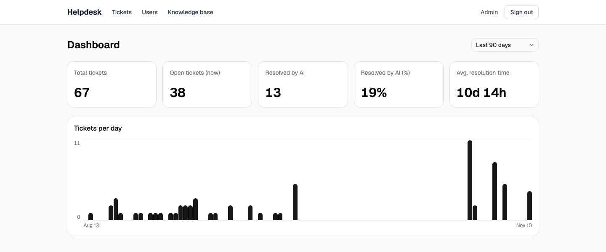
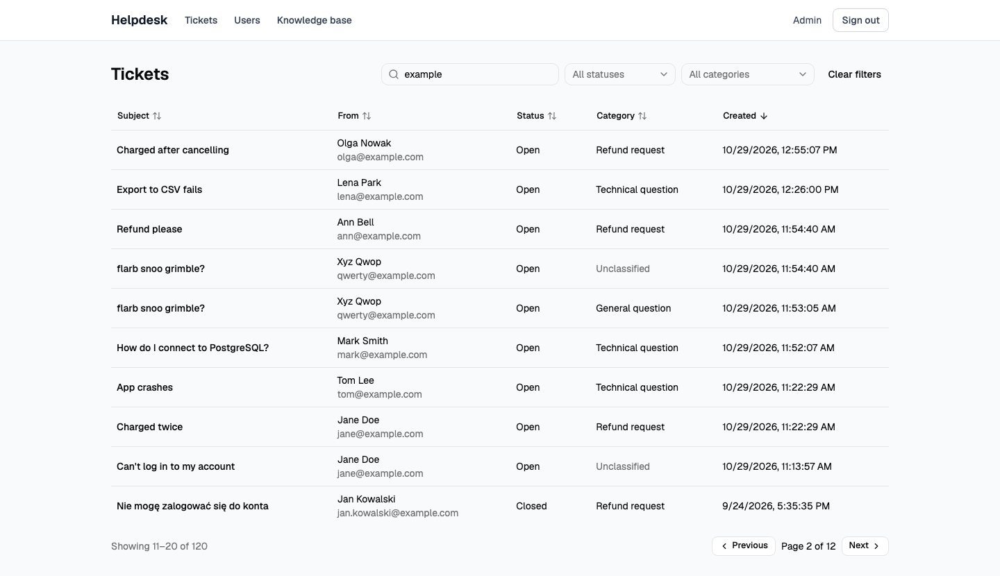
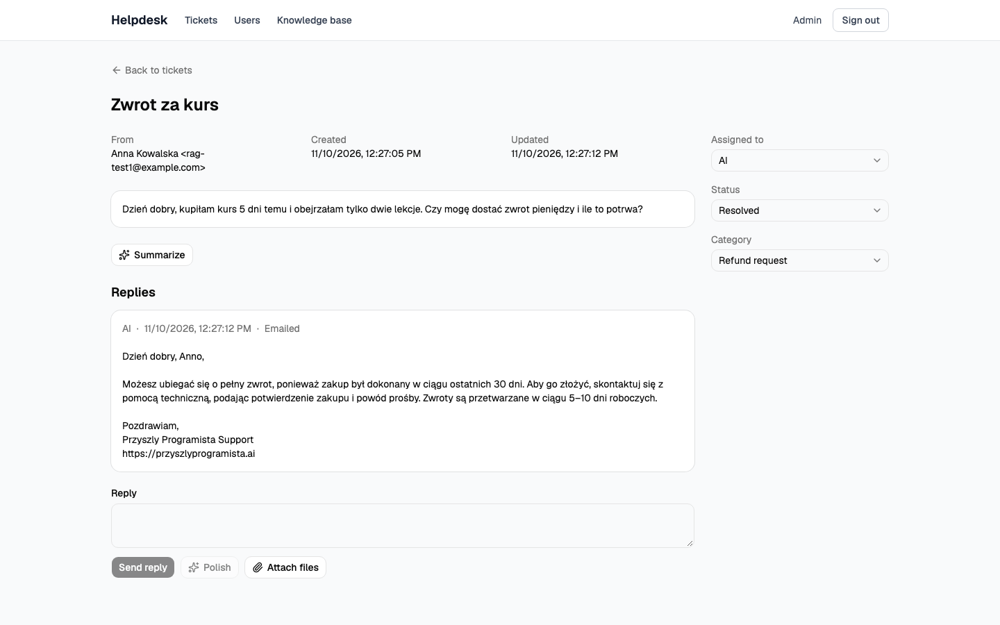
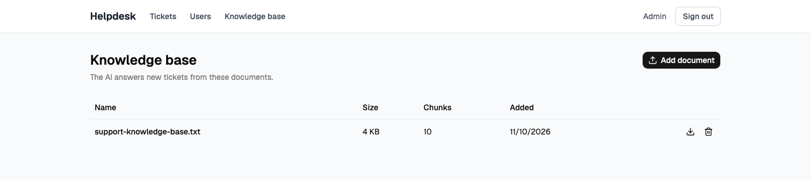

# AI-Powered Helpdesk

A support ticket system that turns customer emails into tickets, answers the ones it can from a knowledge base, and routes the rest to human agents — with AI classification, summaries and reply polishing along the way.

Built as a Bun monorepo: a React client, an Express API, a small mail server, and a Python RAG service.



## Screenshots

| Ticket list | AI-resolved ticket |
|-------------|--------------------|
|  |  |



## Features

**Tickets from email**
- An IMAP/SMTP mailer polls the support mailbox and posts every email to a secret-guarded webhook, which creates a ticket (with attachments) or threads it onto an existing one via `In-Reply-To` / `References`.
- Redelivered emails are deduplicated by `Message-ID`; a customer reply reopens a resolved ticket.
- Agent and AI replies are emailed back to the customer, threaded into the original conversation.

**AI**
- **Auto-resolve** — a new ticket is searched against the knowledge base; if the excerpts answer it, the AI replies in the customer's language and resolves the ticket, otherwise it's opened for an agent. Escalation rules (e.g. account security) live in the system prompt.
- **Classification** — every new ticket is categorised in the background (General / Technical / Refund Request, or left unclassified when unclear).
- **Summary** — one click summarises the whole thread.
- **Polish** — rewrites an agent's draft into a friendly reply, with greeting and signature, in the draft's language.
- AI jobs run on a Postgres-backed queue (pg-boss) with retries, so the webhook never waits on the model.

**Agents and admins**
- Ticket list with server-side search, filtering, sorting and pagination, all kept in the URL.
- Ticket detail with the email (sanitised HTML), attachments, reply thread with email delivery status, and editable assignee, status and category.
- Dashboard with ticket totals, open backlog, AI resolution rate, average resolution time and a tickets-per-day chart over a chosen period.
- Admin-only user management (create, edit, soft-delete agents) and knowledge base management (upload / download / delete PDF and TXT documents).

**Security**
- Session auth with Better Auth, sign-up disabled, admin/agent roles enforced on the server.
- Production rate limiting per IP and per account on sign-in.
- Sender HTML is sanitised with DOMPurify; attachments are always served as downloads with `nosniff` and a sandbox CSP.
- Shared secrets (constant-time compared) between the server, the mailer and the RAG service.

## Architecture

```
          IMAP / SMTP
               │
        ┌──────┴──────┐  webhook   ┌──────────────┐   search   ┌──────────────┐
        │   mailer    │──────────▶│    server    │──────────▶│     rag      │
        │ Bun+Express │◀──────────│   Express    │           │   FastAPI    │
        └─────────────┘   /send    │ Prisma, AI,  │           │  LangChain   │
                                   │   pg-boss    │           │  pgvector    │
                                   └──────┬───────┘           └──────┬───────┘
                         /api (proxy)     │                          │
        ┌─────────────┐◀────────────────▶│                          │
        │   client    │            ┌──────┴───────┐           ┌──────┴───────┐
        │ React+Vite  │            │   helpdesk   │           │ helpdesk_rag │
        └─────────────┘            │  PostgreSQL  │           │  PostgreSQL  │
                                   └──────────────┘           └──────────────┘
```

| Workspace | Description | Port |
|-----------|-------------|------|
| `client/` | React 19, Vite, Tailwind v4, shadcn (Base UI), TanStack Query & Table, react-router | 5173 |
| `server/` | Express 5 on Bun, Prisma 7 + PostgreSQL, Better Auth, Vercel AI SDK (OpenAI), pg-boss | 3001 |
| `mailer/` | Bun + Express, `imapflow` / `mailparser` inbound, `nodemailer` outbound | 3002 |
| `rag/`    | Python, FastAPI, LangChain, pgvector, `text-embedding-3-small` (managed with `uv`) | 3003 |
| `core/`   | Shared Zod schemas and enums used by both client and server | — |

## Getting started

> **Note:** these instructions are for people who have received written permission from the copyright holder to use this software. Without it, running, copying or modifying the code is not permitted — see [License](#license).

### Prerequisites

- [Bun](https://bun.sh)
- PostgreSQL, with the [pgvector](https://github.com/pgvector/pgvector) extension for the RAG database
- [uv](https://docs.astral.sh/uv/) and Python 3.12+ (for the RAG service)
- An OpenAI API key (optional — without it the AI features answer 503 and tickets go straight to agents)

### 1. Install

```bash
bun install
cd rag && uv sync && cd ..
```

### 2. Configure

Copy each example file and fill it in:

```bash
cp server/.env.example server/.env
cp mailer/.env.example mailer/.env   # optional: email in/out
cp rag/.env.example rag/.env         # optional: knowledge base / auto-resolve
```

The shared secrets must match across services: `INBOUND_EMAIL_SECRET` (server ↔ mailer), `MAILER_SECRET` (server ↔ mailer) and `RAG_SECRET` (server ↔ rag). Generate them with `openssl rand -hex 32`.

### 3. Database

```bash
bun run --filter server db:migrate        # apply migrations
bun run --filter server db:seed           # create the admin from ADMIN_EMAIL / ADMIN_PASSWORD

# optional demo data
bun run --filter server db:seed:tickets   # 100 sample tickets
bun run --filter server db:seed:replies   # a long conversation on ticket 12
```

### 4. Run

```bash
bun run dev          # server + client
bun run dev:mailer   # mail server (needs mailer/.env)
bun run dev:rag      # RAG service (needs rag/.env)
bun run seed:rag     # load rag/knowledge-base/ into the knowledge base
```

Open http://localhost:5173 and sign in with the seeded admin account.

## Testing

| Layer | Command | Notes |
|-------|---------|-------|
| Component (Vitest + RTL) | `bun run --filter client test` | No server or database needed |
| Server unit (`bun:test`) | `bun run --filter server test` | AI providers mocked, no network |
| Mailer unit | `bun run --filter mailer test` | |
| RAG (pytest) | `cd rag && uv run --env-file .env pytest` | Uses `helpdesk_rag_test` with fake embeddings |
| E2E (Playwright) | `bun run test:e2e` | Resets a separate `helpdesk_test` database (`server/.env.test`) |
| RAG evaluation | `bun run --filter server eval:rag --with-fixtures` | Scores search and auto-resolve on 44 questions (calls OpenAI) |

Type checks: `bun run --filter server typecheck`, `bun run --filter mailer typecheck`, `cd client && bun run build`.

## Project structure

```
client/     React app (pages, components, hooks, lib)
server/     API routes, middleware, AI + queue workers, Prisma schema and seeds
mailer/     IMAP polling and SMTP sending
rag/        Python knowledge-base service and its seed documents
core/       Shared schemas and constants
e2e/        Playwright tests
```

See `project-scope.md`, `tech-stack.md` and `implementation-plan.md` for the original scope and build plan.

## Roadmap

- Creating tickets by hand
- Resending replies whose email failed
- AI-suggested replies
- Dashboard category breakdown and recent tickets
- Docker images and Compose deployment

## License

Copyright © 2026 Artur Nowakowski. All rights reserved.

This repository is public for viewing only. Using, copying, modifying, merging, publishing, distributing, sublicensing or selling this software, in whole or in part, is not permitted without prior written permission. See [LICENSE](LICENSE).
